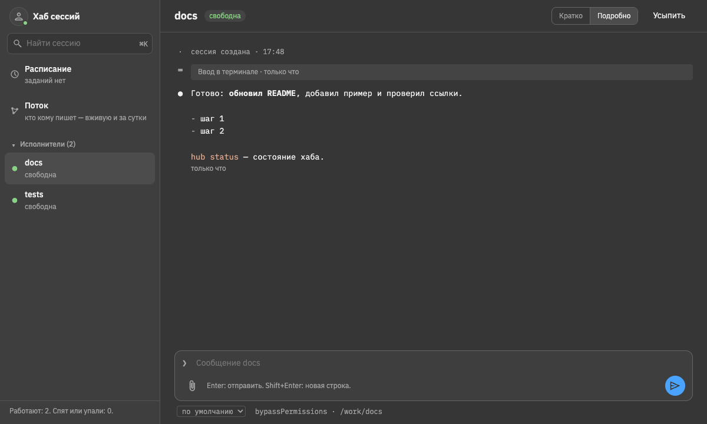

# Dark Optimized — тёмная тема для Agents Hub

Плагин без кода: только тема. Нейтральный тёмно-серый фон, светлый текст с высоким контрастом, спокойные акценты —
палитра в духе тёмной темы Dark+ редактора (VS Code / Cursor). Для долгой работы вечером: глазам мягче, чем чёрный.

## Цвета

| Что | Цвет |
|---|---|
| Фон | `#363636` |
| Панели | `#3e3e3e` |
| Блоки | `#444444` |
| Рамки | `#555555` |
| Текст | `#f0f0f0` (контраст с фоном около 9:1) |
| Акцент | `#4aa3ff` |
| Успех / предупреждение / ошибка | `#89d185` / `#e0b83c` / `#ff6b6b` |
| Код | `#e0a98f` |

## Как поставить

В Agents Hub: «Настройки» → «Плагины» → «Найти» → «Dark Optimized», затем «Настройки» → «Тема» → «Dark Optimized».
Или хабу: «поставь тему dark-optimized» (`hub market install <аккаунт>/<репо>`). Выбор темы хранится в браузере.

## Свои цвета

Откройте `dark-optimized.json`: значения — переменные `tokens.css` страницы (`background`, `foreground`, `primary`, …).
Не заданные цвета хаб выводит из фона, текста и акцента. Формат — в `EXTENDING.md` общего хаба («Темы»).

## Благодарности

Идея палитры — тёмные темы Dark+ (VS Code) и Dark+ Optimized; цвета здесь свои, подобранные под страницу хаба.
Лицензия — MIT.
